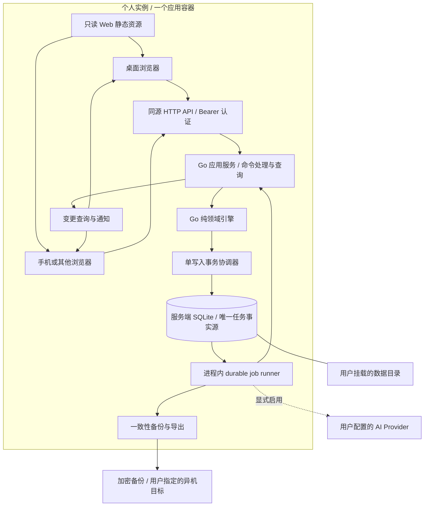

# 晷迹 Web：个人自部署架构方案

建议首期采用 **React／TypeScript 浏览器客户端 + Go 服务 + 服务端 SQLite**，交付一个应用容器和一个持久数据目录。一套实例供一个人使用，多台设备连接同一个服务；官方托管以后复用同一内核。

- Task-ID：`noonmark-web-architecture`
- 更新日期：2026-10-12
- 产品边界：用户已明确取消 Web 本地优先，并确认“个人实例优先；官方托管以后复用同一内核”。
- 状态：设计提案。首期范围已确认，技术实现、镜像、命令及指标尚未交付或验收。
- 分级：本次为 A 级文档变更；后续持久化、鉴权、导入恢复与发行按 P 级推进。
- 阅读顺序：本文 → [数据协议](data-protocol.md) → [自部署与运维](self-hosting.md) → [实施计划](delivery-plan.md) → [外置构建目录](../../engineering/web-build-workspace.md)。

## 1. 已确认目标与原生边界

Web 只有服务端事实源。自部署决定服务和数据由谁运行、放在哪里；它不要求用户注册官方账号，也不把浏览器变成独立数据节点。服务可部署在用户自己的电脑、NAS 或服务器上，浏览器始终通过 HTTP API 访问它。

| 场景 | 首期行为 |
| --- | --- |
| 在个人电脑运行服务 | 浏览器访问本机服务，数据留在服务数据目录 |
| 在 NAS／家庭服务器运行服务 | 多设备访问同一个实例，只有服务器提交事实 |
| 外网断开，但局域网内服务仍可达 | 核心功能照常运行；外部 AI 等可选依赖受影响 |
| 浏览器无法连接实例 | 明确显示不可提交，保留当前输入；不自动离线执行任务命令 |
| 同一人用两个浏览器编辑 | 服务端串行提交，按版本校验并发，第二个客户端拉取已提交变更 |
| 用户不注册官方账号 | 可完成安装、认证、核心使用、导入导出和恢复 |
| 未来官方托管 | 平台运营相同内核，为用户提供独立实例；不是另一种数据模式 |

本轮不改变原生 Mac 的本地优先、iCloud V2、profile、数据模式或 DMG 发行行为。Web 不提供本地优先开关，也不把原生 ADR-0009 的模式切换搬到网页。原生与 Web 的初期互通是用户主动导入导出，连续同步另行设计，当前不承诺。

原方案的浏览器 IndexedDB／OPFS 任务事实库、客户端领域引擎、Go WASM、离线命令 outbox、本地复制 relay、E2EE 多主复制和双模式切换均退出 Web 范围。此前已提交方案可在 Git 历史 `3c261df` 查阅；[ADR-0048](../../adr/0048-propose-web-dual-authority-and-go-backend.md)已被新方向取代。未完成的 Claude 双模式方案对比也随该范围变更结束，不再据其推进实现。

## 2. 现状与参考依据

仓库当前运行面仍是 SwiftPM 原生 App，没有已实现的 Go 服务、Web package、容器入口或 Web deployed endpoint。此次文档更新前本地 `main` 为 `3c261df`，工作区干净。当前环境为 Linux，不具备本仓库原生 WindowServer 验收条件。

| 依据 | 已核实内容 | 本设计采用的约束 |
| --- | --- | --- |
| [CONTEXT.md](../../../CONTEXT.md)、[NoonmarkSnapshot.swift](../../../Sources/NoonmarkCore/NoonmarkSnapshot.swift) | 核心包括 Day、任务链、定义、轨迹、子任务、重复计划、分类及飞光 | 保留完整领域能力，不缩成简单 Todo CRUD |
| [NoonmarkEngine.swift](../../../Sources/NoonmarkCore/NoonmarkEngine.swift) | 可编辑任务定义可复用身份；历史引用决定何时形成新版本 | 按源码语义移植，不假设每次编辑都插入新定义 |
| [MutationClock.swift](../../../Sources/NoonmarkCore/MutationClock.swift)、[ADR-0022](../../adr/0022-use-one-persisted-mutation-frontier-with-exact-clocks.md) | 单一持久 frontier 与精确浮点时钟 | Go 保留 exact clock，不能用毫秒时间戳替代 |
| [NoonmarkDataPackage.swift](../../../Sources/NoonmarkStorage/NoonmarkDataPackage.swift)、[ExactDateJSONCoding.swift](../../../Sources/NoonmarkStorage/ExactDateJSONCoding.swift) | format 7 严格校验，日期编码为 `UInt64` bit pattern | 兼容包必须经无损 codec 与 Swift 对账 |
| [思源 Docker 文档](https://github.com/siyuan-note/siyuan#docker-hosting)、[Dockerfile](https://github.com/siyuan-note/siyuan/blob/master/Dockerfile) | 镜像含界面资源与 kernel，挂载 workspace 并配置访问认证 | 借鉴单实例、单数据目录的部署体验；不引入其代码或照搬笔记数据模型 |

引用的思源部署资料于 2026-10-12 查阅。思源整个产品仍有自己的 local-first 设计；本方案仅借鉴其 Web 自部署的交付方式。Noonmark 的领域引擎、权限和持久化行为仍由本仓库定义。

## 3. 架构与技术选型



| 部件 | 首期选择 | 原因与限制 |
| --- | --- | --- |
| 界面 | React + TypeScript + Vite | 类型化交互与静态发布，不额外运行 Node 业务服务 |
| 浏览器状态 | 查询缓存与当前输入草稿 | 不保存第二份可执行任务事实库，不参与冲突合并 |
| Go 服务 | 标准 `net/http`，模块化单体 | 同进程拥有 API、领域、存储、后台任务和静态资源服务 |
| 数据库 | 服务端 SQLite，WAL，单写入协调器 | 单人多设备场景减少部署依赖；不允许多个服务副本共写同一数据目录 |
| Go 数据访问 | `database/sql` + `mattn/go-sqlite3` + sqlc，显式 SQL migration | 可检查事务和约束；CGO 工具链、SQLite 编译选项与架构在 P0 锁定 |
| API | HTTP JSON + OpenAPI 生成 TypeScript 类型 | 命令、查询、备份作业有明确契约；不同时维护第二套 RPC 协议 |
| 通知 | 带 Bearer 的 fetch stream；断线后重新查询 | 通知不承载可靠提交，序列与 snapshot 才决定客户端状态 |
| 异步任务 | 同库 jobs／outbox，进程内执行器 | 入队与业务同事务；重启后恢复，外部 I/O 不占事务 |
| 分发 | Linux amd64／arm64 OCI 镜像，Compose 为主要入口 | 一个应用容器，不要求 PG、Redis、S3、Kafka 或官方 IdP |
| 可选桌面安装入口 | Web Manifest 后续添加 | 不阻塞首期，不以安装 PWA 作为数据可靠性前提 |

SQLite 可位于应用服务器本机，由服务器代客户端执行领域请求；其并发模型符合本次单写入设计。[SQLite 使用场景说明](https://www.sqlite.org/whentouse.html)支持这一选型条件。SQLite 文件必须在服务主机的本地文件系统／受支持块存储上，不能通过 NFS／SMB 共用 WAL 数据库。[WAL 文档](https://www.sqlite.org/wal.html)说明了相关限制。

驱动需要 CGO，不能宣称任意平台一次纯 Go 静态交叉编译即可交付。[go-sqlite3 项目](https://github.com/mattn/go-sqlite3)是构建约束依据；P0 应验证 amd64／arm64 的实际发行镜像、数据库备份 API 和 context cancellation，而不只验证开发机 build。

SQLite 放在自部署服务器上仍然是服务端事实源。浏览器清缓存、更换设备或卸载可选 PWA，不会删除服务器数据；服务器磁盘损坏仍需依靠备份恢复，不能把单实例说成高可用集群。

## 4. 领域模块与界面行为

| 模块 | 职责 |
| --- | --- |
| `identity` | 单 owner 登录、设备会话、撤销及恢复认证 |
| `instance` | 实例身份、活动 dataset、时区、schema 与维护状态 |
| `core` | Day Todo、任务链、轨迹、子任务、重复计划、分类、飞光及复盘规则 |
| `command` | 鉴权、版本检查、exact clock、幂等、事务提交 |
| `query` | Day、任务池、未来计划、完成／未完成池、重复轨迹和飞光投影 |
| `jobs` | 日结、自动归类、备份、导出及受控 AI 调用 |
| `transfer` | 格式校验、staging、导入、恢复和跨主机搬迁 |
| `zhulong` | scope、会话、建议与用户确认；只通过普通领域命令落地 |
| `diagnostics` | 有界、白名单、无内容的 typed evidence |

Go 实现唯一的 Web 领域引擎。TypeScript 只做输入提示、渲染、导航与请求管理；服务端独立验证全部字段和业务前置条件。现有 Swift 引擎作为差分参考，因此只维护 Swift／Go 两份领域实现，无需浏览器 Go WASM 或第三份 TS 引擎。

日历、未来计划、轨迹、飞光、复盘、子任务、重复任务、分类和有限撤销都列入能力清单。系统级全局快捷键、桌面置顶便签等仍是原生能力；Web 提供应用内对应入口，不据此宣称具有系统权限。界面沿用亮色、减少重复视觉单位的基调。

界面区分“输入尚未提交”“请求结果待确认”“服务端已保存”。乐观动画可以先响应，但不能让未确认命令进入已完成统计、产生后续事实、触发 AI 或导出。采纳 Claude 新提案的草稿恢复思路：浏览器可用 IndexedDB 保存非事实输入，刷新后找回；它不运行领域规则，也不在重连时自动生成任务命令。断线后保留当前编辑内容并提示服务不可达；重新连通先核对不确定命令的 receipt，再刷新版本并由用户决定是否重新提交其他草稿。

## 5. 鉴权、安全与数据控制

首期是一位 owner 的个人实例，不开放注册、多用户共用工作区或协作权限。不要求官方账号、官方登录服务或联网许可证检查才能使用普通清单和恢复能力。

初始化通过同镜像的管理 CLI 从交互输入或受控 secret 挂载取得 owner 初始凭证，使用成熟 Argon2id 实现保存 verifier；禁止默认密码、空密码、URL／命令行明文凭证和匿名远程访问。实例未初始化时 HTTP 服务不暴露可被外网抢注的设置接口。只需管理个人实例认证，不自建 OAuth Provider。

API 遵守仓库 Bearer 约定。登录经 TLS 验证后签发高熵、可撤销的会话 token，服务端只存 token 摘要与有限会话 metadata；浏览器 token 放内存，不放 URL、localStorage 或持久任务缓存。刷新页面重新认证可由浏览器密码管理器辅助；未来“记住设备”必须独立设计与审查。会话到期、密码重置、导入激活和恢复 epoch 变化都能阻断旧写入。

本机 loopback 可用 HTTP；跨主机访问必须配置 HTTPS、公网 origin 与 Host allowlist。只信任显式配置的反向代理；不根据任意 `X-Forwarded-*` 提升权限。默认同源，不开放通配 CORS，不使用 `credentials: include`。关键管理操作重新认证，所有导出／下载同样校验权限。

XSS 会威胁已登录会话与屏幕内容。正文默认纯文本，Markdown 用 sanitizer；禁止用户内容直接执行脚本，使用 CSP、受控依赖和禁止 frame embedding。容器非 root、根文件系统只读、drop capabilities、不开 privileged，不挂载 Docker socket。

Provider API Key 是需要在调用时使用的凭证字符串，服务端使用独立 master key 对其与烛龙私有资料加密；不能把它误称为不可导出的 AES key。key 文件以 secret 挂载／0600 文件保护，业务数据不含明文凭证。自部署管理员拥有主机控制权，服务端可处理明文，不宣称端到端加密或对管理员零知识。

AI 请求经过范围确认、超时、预算和出站控制。允许用户显式配置内网 Provider，但此类配置仅 owner 可修改；后台限制固定目标、重定向与 DNS 解析，不能提供任意 URL 代理。没有 Provider 时普通清单、飞光、手写复盘和本地统计完整可用。

沿用诊断隐私白名单：不收正文、标签、路径、账号、IP、URL、payload、AI 内容、凭证和原始 Error。浏览器诊断不自动上传，服务器 typed 诊断按 allocated bytes 控制在 4 MiB／7 天，单个用户导出最多 8 MiB；容器 stdout、反向代理和 APM 的默认日志也须接受哨兵检查。应用不自动联系官方遥测或上传资料。

## 6. 原生互通与未来托管

Mac 互通首期只做用户主动提供的 format 7 数据包，经 Go 无损解码和完整领域验证后导入。Web 导出同样由 Swift decoder 验证。数据包不携带认证、Provider 凭证或烛龙私有 sidecar；导入时不继承原生端点、设备身份及本地优先开关。不会直接读取 Mac SQLite、原生 production 目录或 iCloud。

未来官方托管优先采用“控制面 + 多个独立个人实例”：控制面管理路由、开通、计费和运维，数据面复用同镜像、同 API 和独立数据卷。控制面不是任务事实源，自部署不依赖控制面。自动调度须先落实持久卷的单实例 fencing，不能靠多副本共享 SQLite 实现 HA。

如果实际托管规模证明实例密度或运维成本不可接受，再评估 PostgreSQL 数据面；不是首期同时支持两套数据库。迁移前必须有容量证据、数据对账与回滚设计。官方托管的可用性、灾备和计费也须独立验收，当前个人单机版不承诺 99.9% 托管 SLA。

## 7. 工程布局与性能预算

```text
App/、Sources/、Tests/                 # 现有 Swift 项目
apps/web/                             # React UI、API client、资源
services/noonmark/                     # Go module
  cmd/noonmark/                        # serve、init、backup、restore 等拟建 CLI
  internal/{identity,instance,core,command,query,jobs,transfer,zhulong}/
  internal/platform/{sqlite,filesystem,diagnostics}/
  migrations/
contracts/{openapi,fixtures}/          # 协议与小型确定性向量
  # Go／TS 生成结果落外置目录，由工具参数引入
  # 不把编译后的前端资源写回源码供 go:embed 使用
deploy/self-hosted/                    # 将来加入镜像与 Compose 声明
scripts/web/                          # 将来加入唯一 build/test 入口
.work -> /share/broker/noonmark-build
```

主交付为镜像内 Go 可执行程序加只读 Web 资源目录，由 Go 同源服务。前端编译资源直接从外置 build 目录装入发行镜像；源码目录不放 `dist`，不以 `go:embed` 为由引入生成文件。当前仅有设计文档，上述运行目录和命令尚未创建。

以下是验收预算，不是测量结果：在固定 2 vCPU／2 GiB Linux 参考机、SSD、一年重度 fixture、10 个同时在线会话下，命令服务端 p95 ≤ 100 ms，常用查询 p95 ≤ 100 ms，健康局域网内第二设备可见 p95 ≤ 2 s。含浏览器、网络和服务器证据一起量测；AI、备份不计入普通命令但不得挤占其资源。

商业质量的重点是可安装、可恢复、可升级、数据不误写及能力完整。单实例故障期间服务不可写是明确边界；具体备份 RPO、恢复 RTO、资源限额和故障测试见[自部署文档](self-hosting.md)。

## 8. 与原方案及 Claude 提案的取舍

保留两份提案共同成立的部分：Go 模块化单体、服务端命令、事务幂等、Swift 行为对账、AI 受控写入、可恢复数据包及真实 E2E。用户取消 Web 本地优先后，客户端 Go WASM、SQLite-WASM／OPFS、客户端复制和跨模式交接已没有对应需求，不继续为它们安排验证或实现。

采用 SQLite 服务端个人实例，取代原方案面向多租户 PG 的首期运行形态。River 的 PG 事务入队和 Connect-RPC 可作为未来独立选型，但当前分别用 SQLite 同事务 jobs 和 HTTP OpenAPI 满足需求，避免让个人安装承担多租户平台的依赖。SQLite driver 在 P0 对比 `mattn/go-sqlite3` 与 Claude 建议的 `modernc.org/sqlite`：前者是当前基准候选，后者减少 CGO 构建负担；按备份、取消、精确值、并发和发行证据决定，不同时交付两个运行驱动。

对 Claude 新版自部署提案的逐项评审见[对比记录](proposal-comparison.md)。评审采纳的是满足已确认范围的机制，不把其尚待讨论的 Cloud、多用户和商业化清单重新变成首期要求。

后续优先级是：外置工具入口 → 单容器真实纵向路径 → 原生领域对等 → 数据包／备份恢复 → 安全与升级门禁。原生能力不因 Web 范围变化而被删除或改写。
