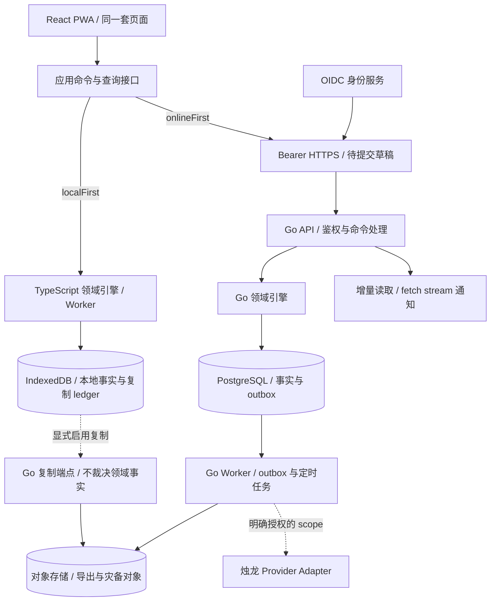

# 晷迹 Web 与 Go 服务端架构方案

建议采用 **React／TypeScript PWA + Go 模块化单体 + PostgreSQL**，以同一套领域契约支撑两条互斥的数据路径：本地优先由浏览器数据库提交事实，账号优先由 Go 服务提交事实。需要评审的核心决定是事实源、模式切换、浏览器数据保障和跨语言一致性；这些决定应先于页面与 API 实现。

- Task-ID：`noonmark-web-architecture`
- 日期：2026-10-12
- 状态：设计提案；尚未实现 Web、Go 服务、账号或新同步端点。
- 分级：本次为 A 级文档与目录配置；后续同步、迁移、鉴权和上线按 P 级执行。
- 阅读顺序：本文 → [数据与协议设计](data-protocol.md) → [实施与商业上线门禁](delivery-plan.md) → [构建及测试目录契约](../../engineering/web-build-workspace.md)。

## 1. 需求、范围与证据

本次目标是为现有晷迹增加可商业运营的 Web 客户端和 Go 后端，同时保留无账号使用核心功能的能力。源码与 Git 分支操作留在当前仓库；编译缓存、依赖安装内容、浏览器 profile、数据库和测试报告全部外置。本次交付设计文档与外置目录入口，不建立服务、不操作用户资料、不运行 production App。

2026-10-12 执行 `git fetch origin` 后，`main`、`origin/main` 以及 `git ls-remote --symref origin HEAD` 指向同一提交 `48624929578bf67a9478f160680bc2845c1fb2a5`，领先／落后均为 0；检查开始时工作区干净。提交时间为 2026-08-29T13:32:03-04:00，主题为 `chore(workspace): align generated-state boundaries`。此记录是设计取证基线，不表示后续提交仍停在该 SHA。

| 已核实事实 | 源码／契约依据 | 对 Web 设计的约束 |
| --- | --- | --- |
| 领域名为本地优先、在线优先；两种主写入路径互斥 | [CONTEXT.md](../../../CONTEXT.md)、[ADR-0009](../../adr/0009-mutually-exclusive-data-mode-with-scheduled-backup.md) | 用户所说“账号优先”在本文映射为 `onlineFirst`，不新增第三个枚举 |
| `AppDataMode` 已有两个值，更新模式目前主要修改偏好；本地同步受模式开关约束 | [Models.swift](../../../Sources/NoonmarkCore/Models.swift)、[NoonmarkEngine.swift](../../../Sources/NoonmarkCore/NoonmarkEngine.swift)、[NoonmarkStore+Sync.swift](../../../App/NoonmarkMacApp/NoonmarkStore+Sync.swift) | 不能把已有设置入口当成已完成账号后端或安全迁移 |
| 领域包括 Day、任务链、定义、日轨迹、子任务、重复计划、分类、飞光 | [NoonmarkSnapshot.swift](../../../Sources/NoonmarkCore/NoonmarkSnapshot.swift) | Web 不能缩成只有 `todos(id,title,done)` 的 CRUD 系统 |
| 普通数据包目前为 format 7，要求严格 canonical 结构；日期以浮点 bit pattern 的 `UInt64` 编码 | [NoonmarkDataPackage.swift](../../../Sources/NoonmarkStorage/NoonmarkDataPackage.swift)、[ExactDateJSONCoding.swift](../../../Sources/NoonmarkStorage/ExactDateJSONCoding.swift) | 原样 `JSON.parse` 会有整数精度风险；兼容必须经过专用 codec 与 Swift 对账 |
| 现有复制协议有 immutable publication、producer epoch、seal、frontier 与 fork resolution | [ReplicationEndpoint.swift](../../../Sources/NoonmarkSync/ReplicationEndpoint.swift)、[LocalFirstReplication.swift](../../../Sources/NoonmarkStorage/LocalFirstReplication.swift)、[ADR-0047](../../adr/0047-converge-sync-into-a-durable-replication-runtime.md) | 保留协议语义，不能退化为每次上传全库覆盖远端 |
| 子任务可变字段曾被误当身份，形成同步毒记录 | [FAIL-2026-08-06-01](../../engineering/failure-cases/2026-08-06-subtask-mutable-identity-merge.md)、[CurrentSyncRecordMerger.swift](../../../Sources/NoonmarkSync/CurrentSyncRecordMerger.swift) | 字段身份与合并规则必须逐项建表，不能一律 LWW 或一律不可变 |
| 仓库当前为 SwiftPM；未发现 Go module、Web package、Dockerfile、Compose 或 deployed endpoint | [Package.swift](../../../Package.swift) 与 tracked 文件清单 | 本文所有 Web 运行、性能、安全结论都是待验收目标 |
| 当前宿主是 Linux；原 macOS BUILD 路径不可访问，旧 Makefile 仍有不带 scratch path 的 SwiftPM 命令 | [Makefile](../../../Makefile)、[AGENTS.md](../../../AGENTS.md) | 本次不运行旧构建／测试入口，不把历史 macOS 通过记录当成本机验证 |

成功标准是：两种模式的写入权可证明互斥；离线、重试、跨日、冲突、模式切换、账户切换及恢复有明确行为；安全和运维要求有真实测试门禁；后续每个实施阶段都有可运行交付物。云厂商、商业定价和部署地区尚未确定，本文给出可替换边界及默认容量假设。

## 2. 产品契约

账号负责身份、设备授权、配额和订阅，数据模式负责谁有权提交任务事实。登录不会自动上传本地资料，购买订阅不会自动切换数据模式。

| 行为 | 本地优先 `localFirst` | 账号优先 `onlineFirst` |
| --- | --- | --- |
| 初次使用 | 无需账号；首次装载应用资源仍需网络，之后可离线打开 | 先登录并建立个人 workspace |
| 主事实源 | 该安装的 IndexedDB；其他安装经显式复制收敛 | Go 服务事务提交的 PostgreSQL 数据集 |
| 保存确认 | 本地事务完成后显示“已保存到本机” | 服务端事务确认后显示“已保存到账号” |
| 离线写入 | 完整执行核心领域命令并留下轨迹 | 保存待提交草稿／意图；不能冒充已完成、已排期等事实 |
| 跨设备 | 可选、显式启用的复制端点；登录本身不启用 | 登录后按授权读取云端事实和增量 |
| AI 不可用 | Todo、飞光、复盘及已有本地能力照常可用 | 同左；AI 不在核心写入事务内 |
| 备份 | 用户导出恢复包；可选复制不等于备份 | 服务端灾备 + 用户可恢复导出；定时导出不做双向 merge |
| 切换模式 | 经过冻结、校验和导入到新数据集 | 经过服务端冻结、完整导出与本地校验 |
| 退出账号 | 不删除独立的无账号本地资料；停止需账号的复制权限 | 锁定账号缓存；显式处理未提交草稿和可信设备保留策略 |

“完整核心能力”以原生领域行为为准：Day Todo、任务池、未来计划、日轨迹、延续、有限撤销、子任务、重复计划、分组标签、完成／未完成池、飞光、手写复盘及导入导出。烛龙功能另建同等行为清单，禁止用静态模板冒充 AI。分阶段开发可以先交付子集，但未完成能力对账前不能称为原生等价版，也不能替换原生用户路径。

Web 无法取得 macOS 全局快捷键、桌面置顶便签、Keychain ThisDeviceOnly 或任意 iCloud 文件夹权限。Web 对应提供应用内快捷键、飞光入口与 PWA 窗口；原生系统集成功能继续属于原生客户端。是否另做浏览器扩展／桌面桥接须独立设计，不能以网页弹窗宣称系统能力已经对等。

## 3. 总体结构与选型

PWA 是 Web 客户端的交付和运行形态：用户可在浏览器直接访问，也可在支持的浏览器安装为独立窗口。React 负责页面，TypeScript 应用层负责选择数据路径，IndexedDB 负责本地持久化；Manifest 提供安装信息，Service Worker 缓存应用资源并管理更新。用户第一次取得应用资源后，本地模式可以离线重新打开。Go 服务运行在云端或自托管服务器，不随 PWA 安装到用户电脑。平台能力依据见 [MDN PWA 说明](https://developer.mozilla.org/en-US/docs/Web/Progressive_web_apps/Guides/What_is_a_progressive_web_app)。

PWA 本身不提供任务同步、领域一致性或账号系统。这些能力分别由下面的本地 runtime、复制协议和 Go 服务实现；Service Worker 不能成为第二个事实写入者。安装 PWA 也是可选操作，不改变两种数据模式的语义。



客户端同一时刻只装配一个主数据 adapter。`LocalWorkspace` 与 `AccountWorkspace` 使用不同数据库 namespace、不同命令处理器和不同保存状态。UI 不直接访问 IndexedDB、SQL 或同步 API；按数据模式装配应用接口的责任集中在一个 runtime 中。

| 组件 | 建议 | 决策理由与边界 |
| --- | --- | --- |
| Web | React + TypeScript + Vite，PWA 应用壳 | 交互型私有数据应用无 SSR 必需；避免另建 Node 业务后端。营销站如有 SEO 需求单独部署 |
| 本地持久化 | IndexedDB + Dexie，Worker 内领域处理 | 事务、浏览器覆盖与多页签是当前优先项；不直接移植 SQLite 文件 |
| Go HTTP | 标准 `net/http`，显式 middleware，OpenAPI 契约 | 简化运行面；业务逻辑不依赖框架上下文 |
| Go 持久化 | PostgreSQL + pgx + sqlc，版本化 SQL migration | 事务、约束和 RLS 保持可检查，避免 ORM 自动迁移掩盖 schema 变更 |
| 进程 | 同一 Go module，API 与 Worker 两种启动角色 | 可独立扩容和限流，领域包共享；初期不拆微服务 |
| 异步任务 | PostgreSQL outbox + jobs 表 | 业务提交和任务入队同事务，不必引入 Kafka 来补双写漏洞 |
| 大对象 | S3 兼容私有对象存储 | 导出包和复制对象；对象存储不承载在线任务事务 |
| 登录 | 支持 OIDC／PKCE 和 passkey 的成熟身份服务 | Noonmark 不自研密码系统；自托管选项通过标准协议保留 |
| 观测 | OpenTelemetry 接口、指标、白名单结构化事件 | 默认关闭内容采集，沿用现有诊断隐私边界 |

Redis、搜索集群、Kubernetes、消息总线和多地域多主都不作为首期依赖。仅当量测显示 PG 队列、单地域写入或搜索成本超过目标时再引入，并记录替换条件。所有实际依赖版本与镜像 digest 在 P0 锁定；本文不把浮动 `latest` 当作可复现配置。

SQLite WASM／OPFS 是备选，不是当前默认：它不能消除浏览器配额和清站点数据风险，还引入 VFS、Worker 与跨页签并发设计。若 IndexedDB 在规定一年数据集下无法满足查询目标，先量测索引与投影，再用同一契约测试比较 SQLite WASM。不同 VFS 的并发与响应头要求应以 [SQLite 官方持久化说明](https://sqlite.org/wasm/doc/tip/persistence.md)为准。

## 4. 领域与模块边界

| 模块 | 拥有的数据及能力 | 禁止跨界 |
| --- | --- | --- |
| `identity` | OIDC subject 映射、会话、设备授权 | 不持有任务领域写入方法 |
| `workspace` | 个人 workspace、成员角色、dataset mode／epoch、迁移状态 | 不按客户端传入的 owner 字段授权 |
| `todo` | Day、TaskChain、TaskDefinition、DayTrace、Subtask、重复计划与分类事实 | 禁止通用 `PATCH trace` 改写历史 |
| `flylight` | `IdeaEntry`、时间线、删除与恢复语义 | 不依赖 AI Provider；沿用内部兼容标识 |
| `review` | 日统计投影、复盘文本及创作来源 | 补写复盘不能解锁当日任务事实 |
| `replication` | publication、receipt、cursor、fork evidence | 不成为账号优先的第二个 merge 引擎 |
| `transfer` | 校验、数据包、模式切换、恢复任务 | 普通导入不能静默覆盖非空账号数据集 |
| `zhulong` | scope、会话、建议、确认、异步调用 | AI 只提出命令；必须经同一领域校验和用户确认 |
| `billing` | 产品权益、配额、计费事件 | 订阅过期不能删除事实或阻断导出 |
| `diagnostics` | 有界 typed evidence | 不收任务正文、Provider 内容或原始错误 |

Go 与 TypeScript 各有可独立测试的纯领域包。两者共享的是命令 schema、字段语义、状态机和黄金向量，不是假设“两份翻译后的代码天然等价”。Swift 现有实现是重要行为参考，已知缺陷仍需依据领域不变量判断；三份引擎通过同一输入序列与规范化快照对账。具体 wire、日期与 codec 约束见[数据协议](data-protocol.md)。

建议的未来源码布局如下，当前不创建空实现目录：

```text
App/、Sources/、Tests/             # 现有 Swift 客户端
apps/web/                         # React UI、Worker、PWA
packages/domain/                  # TypeScript 纯领域引擎
packages/contracts/               # 手写协议与类型入口
packages/local-store/             # IndexedDB schema 与事务边界
packages/replication/              # 浏览器复制 runtime
services/noonmark/                 # Go module
  cmd/noonmark-api/
  cmd/noonmark-worker/
  internal/{identity,workspace,todo,flylight,review,replication,transfer,zhulong,billing}/
  internal/platform/{postgres,objectstore,auth,observability}/
  migrations/
contracts/{openapi,schema,fixtures}/ # 可评审的规范与小型人工／确定性向量
deploy/{compose,production}/       # 声明配置；无状态文件和凭证
scripts/web/                      # 唯一构建、测试、目录守卫入口
.work -> /share/broker/noonmark-build
```

生成的 SDK、二进制、数据库和批量 fixture 落到 `.work` 的真实目标。契约、migration、lockfile 和小型可评审测试向量属于源码；测试运行输出不属于源码。

## 5. 浏览器可靠性

浏览器事务成功表示已经提交到该 origin 的存储，不是灾备承诺。持久化申请可能被拒绝，存储受配额影响，清除站点数据会删除 IndexedDB 与 OPFS；应用必须用 `navigator.storage.persist()`／`estimate()` 显示真实状态，处理配额错误并保留未提交编辑。[MDN 存储配额与清除规则](https://developer.mozilla.org/en-US/docs/Web/API/Storage_API/Storage_quotas_and_eviction_criteria)是平台边界依据。

每个本地命令在一个 IndexedDB transaction 内提交领域行、历史事实、版本、待复制 journal 和命令结果。UI 必须等待事务 completion，再显示保存状态；不能在键入事件或 request success 时提前确认。网络请求和长时间异步计算放在事务外，在事务内重新核对版本，避免 IndexedDB 自动结束事务。[Dexie transaction 说明](https://dexie.org/docs/Dexie/Dexie.transaction%28%29)支持这一边界。

同 origin 多页签通过 Web Locks 选复制 worker，BroadcastChannel 通知界面刷新；正确性仍依赖事务内版本检查和唯一键。锁不承担跨设备共识，页签挂起或 worker 消失后可由 durable ledger 接续。[Web Locks API](https://developer.mozilla.org/en-US/docs/Web/API/Web_Locks_API)只协调同 origin 上下文。

PWA 缓存只收版本化静态资源，不缓存 Bearer token、AI 响应或认证 API。服务 worker 在全部客户端释放旧 schema 后才切换需要 migration 的版本；旧页签收到 `versionchange` 必须关闭数据库连接并要求保存草稿后刷新。迁移失败保留旧数据库与可导出内容，不能清库“修复”。

后台同步、关闭浏览器后的定时备份和通知送达不能作为可靠性前提。本地日结在启动、恢复焦点及执行命令时补算；账号日结由服务端 worker 执行且命令路径兜底。用户主动导出的文件需要显式下载／授权；浏览器不能悄悄给本地磁盘做定时备份。

本地模式的商业交付至少具备：重启回读、配额告警、最后导出时间、写后可校验的恢复包、恢复演练和可选多设备复制。完全无账号且没有外部备份时，浏览器 profile 损坏无法由服务端恢复；产品必须准确表达这一限制，不承诺零数据丢失。

## 6. 账号、安全与隐私

### 身份与租户

首期只开放个人 workspace；schema 预留 `workspace_members`，团队共享需独立产品与授权设计。JWT 的 `sub` 只映射用户，服务端每次按已验证 subject、workspace 成员关系、dataset 与动作权限授权；不能仅验证签名就放行对象 ID。删除成员／注销账号会增加授权版本并撤销会话及设备。

登录使用 OIDC Authorization Code + PKCE S256，核对 issuer、audience、nonce、state 和 redirect URI；不用 implicit flow。访问 token 短时有效、只放内存，刷新 token 若使用必须轮换且只留会话内存；刷新／重新打开页面经身份服务重新认证，不落 localStorage／IndexedDB。采用 [RFC 9700](https://www.rfc-editor.org/rfc/rfc9700.html)作为 OAuth 安全基线。

应用 API 统一 `Authorization: Bearer ...`，同源 `/api/v1` 反代；不使用跨域 `credentials: include`。若以后允许跨源，CORS 必须精确 origin allowlist。流式通知使用可带 Authorization 的 `fetch` stream，不把 token 放入 URL，也不依赖不能自定义该 header 的原生 `EventSource` 用法。服务端身份服务自身的登录会话 cookie 不授予 Noonmark API 权限。

账号缓存以 `(environment, origin, issuer, subject, dataset_id)` 隔离。共享设备默认不持久保存账号事实；可信设备缓存为显式选择。退出时停止 worker、清除 token、默认清除账号事实缓存并广播到其他页签；未提交草稿须先由用户选择保留为独立本地草稿或删除，不能上传到随后登录的另一个账号。若提供退出后保留缓存，必须使用独立本机解锁和加密方案，密钥不能与密文一起明文存放；隐藏 UI 不等于锁定数据。离线设备不能被远程保证立即擦除，此限制同样适用于撤销后的本地副本。

### 数据与攻击面

所有租户表含 `workspace_id`，使用复合外键防止跨租户引用。PostgreSQL 启用并强制 RLS，API／worker 角色不是 owner、superuser 或 `BYPASSRLS`；每个事务 `SET LOCAL` 授权 scope，连接池归还后不得泄漏上下文。migration 用单独权限，缺 scope 默认拒绝。RLS 不能替代业务授权，也不能抵御已完全被攻陷且能任意设置 scope 的服务端。[PostgreSQL RLS 文档](https://www.postgresql.org/docs/current/ddl-rowsecurity.html)说明了 owner 和高权限绕过边界。

XSS 可以读取运行中的本地任务和内存 token，是两种模式的共同高风险。正文默认纯文本；Markdown 必须 sanitizer；限制 CSP、禁止任意脚本与 HTML 注入，应用页不引入广告或第三方分析脚本。使用受控依赖、lockfile、SBOM、漏洞扫描、镜像签名和最小容器权限。

API、导入和复制按账号／设备分别限流，同时限制请求字节、解压大小、嵌套深度、实体数量和单批处理时长；超限返回 typed rejection，不能让一个大包耗尽整个 worker。导出下载使用短时、只读、限定单对象的授权；签发前重新核对权限，URL 和下载凭证不进入日志。实际阈值由一年重度数据集与恶意输入测试共同确定，作为发布配置审查项。

账号模式采用 TLS、数据库／备份静态加密与 KMS 管钥，服务端可处理明文，不宣传为 E2EE。可选本地复制托管端点建议采用独立版本的客户端加密 envelope；其密钥恢复、设备授权和 metadata 泄漏见协议文档，审计完成前不开放该功能。

托管 API Key 在服务端凭证库加密保存，不进入配置文件、日志、导出包或普通同步。无账号用户若使用浏览器直连 Provider，凭证只留会话内存且受 Provider CORS 限制；持久 BYOK 或跨域代理必须另行选定安全方案。代理不得接受任意内网 URL；自定义 Provider 需要 SSRF、DNS 重绑定和出站 allowlist 防护。

诊断沿用现有白名单：不记录任务、标签、路径、账号、邮箱、IP、URL、payload、原始 Error 或 AI 内容；本地日志不自动上传。浏览器无法可靠查询 allocated bytes，Web 以编码字节数最多 4 MiB／7 天及单个导出最多 8 MiB 限流，但不得宣称满足原生 allocated-bytes 度量。服务端只自动采集必要聚合指标与 typed operation／incident；网关、CDN、APM 默认访问日志也必须接受相同隐私审查，不能在业务层脱敏后由代理重新记录。

任务历史不可无痕编辑是领域规则，不意味着用户不能删除账号。账号删除要求重新认证、停止新写入和导出任务、撤销凭证、按明确保留期限删除业务数据及最终过期的备份；恢复旧备份时须重放删除账本，避免已注销资料复活。现有真实 iCloud append-only 铁命继续适用，服务端删除策略不得据此回写或清理 iCloud。

## 7. 商业运行目标

以下数字是首轮验收预算和容量假设，不是当前已达到的指标。上线前以实际硬件、数据量和网络条件重测。

| 项目 | 首期目标／假设 | 验证口径 |
| --- | --- | --- |
| 容量 | 10,000 月活、1,000 同时在线，每人每日 100 个命令 | 约 100 万命令／日，平均约 12/s；以 20 倍突发约 240/s 压测 |
| 账号 API 可用性 | 月度 99.9% | 用户有效请求成功率；429／5xx 及身份依赖故障单独统计，不能隐藏依赖不可用 |
| 本地保存 | 一年数据集下 p95 ≤ 50 ms、p99 ≤ 150 ms | 从输入确认到事务完成，不包含 IME composition；固定桌面基准机 |
| 在线命令 | 服务端 p95 ≤ 200 ms、端到端 p95 ≤ 500 ms | 同部署区域正常网络；不包含 AI／大包导入 |
| 在线增量可见性 | 健康网络下 p95 ≤ 2 s | 从服务端提交到第二客户端应用，而非只测消息投递 |
| 常用页面 | 一年数据集下本地查询 p95 ≤ 100 ms | Day、飞光、完成／未完成池、重复轨迹均测长列表 |
| 单可用区故障 | 已确认在线事务 RPO = 0，目标恢复 ≤ 5 分钟 | 要求同步复制／对应托管 HA 承诺；故障注入验收后才能对外承诺 |
| 地域灾难 | RPO ≤ 5 分钟、RTO ≤ 60 分钟 | 连续 WAL 归档／跨故障域备份与完整恢复计时 |

若每命令净增 2 KiB，一天约新增 2 GB 原始变更，索引、副本和备份会继续放大；该假设用于成本试算，不用来预先证明容量足够。压测至少覆盖单个重度账号、多小账号、突发补同步、导出并行与慢客户端，量测连接池、I/O、磁盘放大和每活跃账号成本。

首期部署为单地域多可用区：CDN 静态资源、至少两个 Go API 实例、独立 worker、托管 HA PostgreSQL、私有对象存储和 secret manager。worker 每次领取任务有 lease／fencing，业务效果按命令幂等；进程崩溃后重领，不声称消息只投递一次。Provider 若不支持请求幂等，超时后无法排除已调用和已计费，不盲目自动重试；记录 typed 不确定状态并提供明确重试选择，核心命令应用仍去重。扩容 API 不会提高单 dataset 的串行提交速度，必须单独监控重度账号排队。

上线需具备数据库 PITR、对象备份、密钥恢复、整站恢复 runbook 和值班责任人；每月演练隔离恢复，每季演练故障域切换。服务端备份不是用户侧数据包，两者均须可恢复验证。账户计费 webhook 需验签、重放防护与账本幂等，配额从持久账本派生；限额、欠费与 AI 预算都不能影响用户读取和导出已有数据。

采用低基数指标：事务成功率／延迟、队列年龄、复制等待、fork 数、迁移停滞、恢复耗时、存储额度及匿名 typed error。分页 SLO 告警、错误预算消耗告警和恢复失败告警均须有 runbook；不把用户 ID、任务 ID、正文或 digest 放进指标标签。

## 8. 决策边界与待确认项

| 选项 | 本方案选择 | 何时重审 |
| --- | --- | --- |
| 微服务或模块化单体 | 模块化单体，API／worker 分进程 | 团队、隔离需求或单模块负载足以抵偿分布式事务成本 |
| 两种模式共用自动双向同步 | 两个明确 adapter、两个 dataset authority | 不合并，除非重新定义在线优先的产品契约 |
| 所有字段套 CRDT／LWW | 按字段继承现有语义，领域冲突显式处理 | 将来有多人同文编辑需求时，对独立文本字段评估 CRDT |
| 在浏览器直接重用 Swift | TS／Go 领域引擎 + Swift 差分向量 | Swift WASM 完整平台及调试成本经量测优于双实现时 |
| 所有用户强制登录 | 无账号本地路径 | 不改变；这是本项目核心价值 |
| 直接桥接现有 iCloud | 首先验证数据包，之后设计原生 HTTPS adapter | 精确 wire／merge／恢复门禁全部通过后才允许接入 |

默认先做个人效率产品、桌面 Web 优先，移动浏览器是同套领域能力下的响应式适配。正式开发前应确定首发地区和预算、账号供应商、可信设备缓存默认值、本地复制是否纳入首发、烛龙 Web 的 BYOK 方式，以及团队共享是否另期。未知项通过 adapter 和门禁隔离，不作为偷减核心领域能力的理由。
