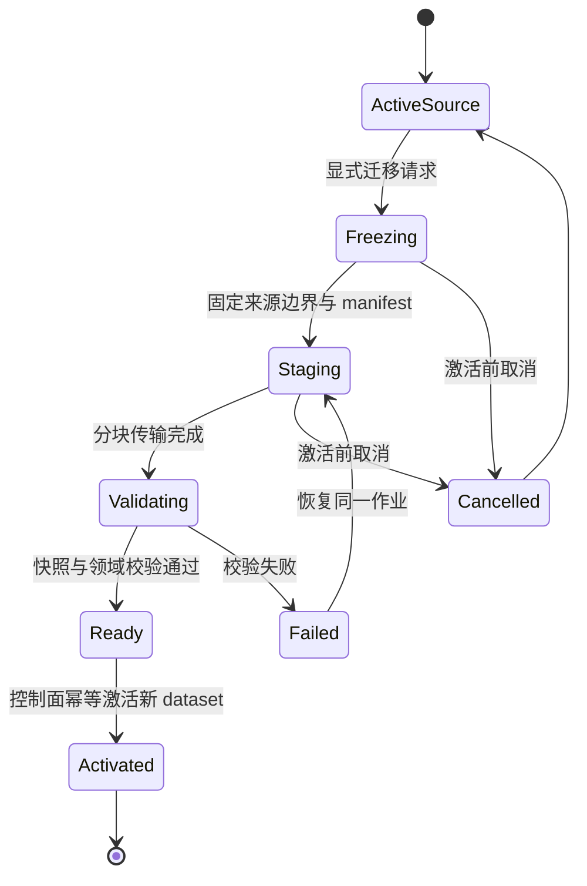

# Web 数据、同步与模式切换协议

本提案把本地保存、服务端提交、复制确认和迁移激活定义为四种不同的持久化边界。任何 UI、API 或后台任务都不能把其中一种成功冒充另一种成功。

- Task-ID：`noonmark-web-architecture`
- 状态：提案；接口名、表名与错误码是实施契约草案，尚未存在对应服务。
- 上位方案：[架构方案](README.md)；原生语义以 [CONTEXT.md](../../../CONTEXT.md) 和现有引擎为准。

## 1. 数据所有权

`workspace_id` 是账号授权范围；`dataset_id` 是一份具有独立主数据模式的事实集合。无账号本地 dataset 不要求 `workspace_id`。登录后可拥有多个独立 dataset，但一个客户端会话只激活一个主数据 runtime；同一个 dataset 不同时接受本地复制和在线命令。

模式属于 dataset authority，不能只放在可随意修改的 UI 偏好里。`authority_epoch` 是单调控制版本；进入冻结、切换或撤销状态后，旧 epoch 的在线命令和托管复制发布必须被拒绝。离线本地副本不具备实时撤销能力，切换采用新 dataset ID，详见第 6 节。

| 存储 | 主要表／object store | 不变量 |
| --- | --- | --- |
| 账号控制面 | `users`, `workspaces`, `workspace_members`, `datasets`, `devices`, `migrations` | 身份 subject 与业务 ID 分离；mode、epoch、状态变更事务化 |
| 领域事实 | `days`, `task_chains`, `task_definitions`, `day_traces`, `subtasks`, `task_cycle_series`, 分类事实、`idea_entries` | 按原生身份与关系建模，带 tenant／dataset 复合引用 |
| 提交与增量 | `command_receipts`, `dataset_sequences`, `change_batches`, `outbox`, `jobs` | 领域写入、receipt、增量批次与 outbox 同事务 |
| 本地复制 | `local_journal`, `sealed_publications`, `receipts`, `frontiers`, `conflicts`, `producer_state` | journal 与领域事实同事务；确认集合单调；cursor 不越过未应用批次 |
| 浏览器在线缓存 | `account_projection`, `pending_intents`, `pull_checkpoint` | 草稿不计入已确认事实；切账号不能复用 |
| 独立 sidecar | 烛龙会话、建议、记忆、Provider reference | 普通数据包不夹带 sidecar 或凭证；领域保留必要创作来源 |

核心结构使用带类型的列、外键与检查约束；JSONB 只用于版本化命令／事件 body、确需灵活的建议内容。不能把整个 workspace 存成一个可覆盖 JSON。历史事实追加、当前态更新与查询投影并存，不为首期强行引入全量 Event Sourcing；用于复制的变更日志也不能替代领域历史。

数据库至少约束 `(dataset_id, day_date)` 唯一、同一任务链最多一个活跃日轨迹、命令 ID 唯一、重复实例 occurrence key 唯一、parent 与 child 同 tenant／dataset。不能用数据库任意 UPDATE 来实现跨日移动；命令必须留下来源轨迹和延续关系。飞光删除／恢复仍按其领域规则执行，不能将“任务历史不可删除”机械套在所有实体上。

## 2. 命令、日期与跨语言契约

应用层示意接口：

```ts
interface WorkspaceRuntime {
  execute(command: DomainCommand): Promise<CommitResult>;
  query(query: DomainQuery): Promise<Projection>;
  subscribe(listener: (state: RuntimeState) => void): () => void;
}

type CommitResult =
  | { kind: "localCommitted"; revision: string }
  | { kind: "serverCommitted"; revision: string; commandId: string }
  | { kind: "pendingIntent"; intentId: string }
  | { kind: "rejected"; code: string };
```

候选命令包括 `CreateTask`、`ScheduleTask`、`CompleteTrace`、`ContinueTask`、`ReturnToPool`、`ReviseTask`、`UpdateSubtask`、`ReviseRecurringPlan`、`WriteReview`、`CaptureIdea`、`ApplyConfirmedAIProposal`。实施时逐条映射现有领域方法，补齐所有现有用户动作；这份示意清单不是功能删减清单。

每个命令带 `command_id`、`dataset_id`、`authority_epoch`、`schema_version`、目标聚合的 `expected_revision`、显式日历上下文和 typed payload。新实体 ID 在命令生成时固定，重试不重新生成。服务端签发的设备写入 epoch 也进入账号请求；退役设备的旧命令不重新执行。

wire 规则：

- UUID 用规范字符串；revision、sequence 以及可能超过 JavaScript 安全整数的值全部用十进制字符串；不用 JS `Number` 接收 `UInt64`。
- Web 新 API 的时间点采用明确 UTC、固定精度的 RFC 3339 字符串；业务日期采用有效的 `YYYY-MM-DD`，另带 IANA timezone。禁止以“加 24 小时”推导下一个自然日。
- 本地模式按设备日历上下文执行，与原生进行时区／夏令时／回拨对账。已锁定历史不能因改系统时钟重新打开。
- 账号模式建议 dataset 持有明确 `calendar_timezone` 及其版本；由服务器时间判断今天，变更时区显式确认且只影响后续日历归属。该规则是新提案，与原生设备时区行为不同，需单独验收。过期草稿碰到已锁定日返回 `DAY_LOCKED`，保留草稿并要求用户重新决定排期，不能伪造昨天已完成。
- 随机数、ID、时钟和日历从外部注入领域引擎，使 Swift、TS、Go 可执行完全相同的命令序列。

### 原生 format 7 的专门风险

当前数据包不是普通 ISO 日期 JSON：`ExactDateJSONCoding` 存储以 Apple reference date 为基准的浮点秒数 bit pattern，作为 `UInt64` JSON 数值；`NoonmarkDataPackage` 还要求精确 canonical 编码。TS codec 必须在解析前以无损数字 tokenizer 保留该整数，使用 BigInt／DataView；Go 使用 `json.Number`／`uint64` 与明确的 bit 转换。原始 bit 值和身份字段必须保留，不能先转成毫秒再试图还原原字节。

在 format 7 适配器内，验证 raw bytes、字段集合、排序、日期、引用和 snapshot integrity；只在全部通过后转换为内部模型。导回 format 7 时重新生成精确格式并由 Swift decoder 验证。未来 Web API 不沿用 bit-pattern 日期，新协议版本与旧包 codec 分开管理。没有 byte-level golden 和 Swift 双向 round-trip 证据，就不能开放“与 Mac 兼容导入导出”。

契约向量还必须覆盖 Unicode、空标题既有任务、非法新任务、分类批次、有限撤销、子任务 lineage、重复计划修订、飞光 tombstone、AI 来源、历史锁定和偏好同步白名单。账户、模式、端点、凭证和设备身份不从导入包继承为授权。

## 3. 在线提交与增量投影

首期按 dataset 串行化提交，降低日结、重复计划与跨聚合变更的竞态。事务中先锁 dataset control／sequence 行，再按固定顺序读取并校验受影响聚合；使用 `READ COMMITTED + 显式锁` 配合唯一约束。若后来改为细粒度锁或 Serializable，必须以相同并发不变量重新验收，并完整重试序列化失败的事务。[PostgreSQL 隔离文档](https://www.postgresql.org/docs/current/transaction-iso.html)说明了快照及重试边界。

一次命令的事务顺序：

1. 校验身份、成员关系、dataset mode、authority／device epoch、冻结状态和配额。
2. 查 `(dataset_id, device_epoch, command_id)` receipt；同 payload hash 返回原结果，不同 payload 返回 `IDEMPOTENCY_MISMATCH`。
3. 核对 expected revision、日结状态与领域不变量；必要的补日结和本命令共享可确定的提交顺序。
4. 写领域事实与历史，递增 dataset sequence，写完整 `change_batch`、receipt 和 outbox。
5. COMMIT 成功后返回结果；之后 worker 才发布通知、执行导出或外部 AI 调用。

dataset sequence 是同一锁保护下、与事实同事务更新的行值，不能用事务提交前已分配的全局 `BIGSERIAL` 高水位直接跳过尚未提交的事务。请求超时不等于失败；客户端通过同 command ID 查询／重试。事务回滚不留下半个命令的事实或通知。

receipt 至少保留整个活跃 device epoch 的去重摘要；大响应可压缩或改为引用已保留批次。注销／退役 epoch 后即拒绝它的新请求，不能因为删除旧 receipt 而再次执行历史命令。唯一键处理同时到达的重复请求；不得先 SELECT 未发现、再无保护地执行两次。

查询与订阅接口草案：

| API | 语义 |
| --- | --- |
| `POST /api/v1/datasets/{id}/commands` | 原子命令提交，返回 receipt／typed rejection |
| `GET /api/v1/datasets/{id}/commands/{commandId}` | 在设备 scope 内查询不确定提交结果 |
| `GET /api/v1/datasets/{id}/snapshot` | 返回同一数据库快照下的事实／投影与 checkpoint；大包先生成 immutable snapshot |
| `GET /api/v1/datasets/{id}/changes?cursor=...` | 按完整事务批次分页，授权校验不依赖 cursor 本身 |
| `GET /api/v1/datasets/{id}/events` | fetch stream 只通知有新数据；丢消息后仍按 checkpoint pull |
| `POST /api/v1/datasets/{id}/exports` | 异步建立可校验恢复包；返回 job reference |
| `POST /api/v1/migrations` | 建立幂等迁移作业，查询状态后才可激活 |

snapshot 的读取上下文与返回 checkpoint 必须来自同一 MVCC 一致视图；不能分两次无隔离查询拼接。`changes` 只含已提交批次；一个事务不能被分页拆成半批。客户端在一个本地事务里应用整批并更新 checkpoint。Web 缓存只是在线事实的派生视图，丢失后可全量恢复。

cursor 绑定 dataset、epoch、schema 和读取范围，是不透明且可验证的定位符，不是权限凭证。change log 过期返回 `CHECKPOINT_EXPIRED`，客户端重新 bootstrap；未提交意图独立保留，重新校验后再提交。默认不自动回放会完成、延期、废弃或改写排期的跨日意图；用户确认后提交。

类型化错误至少区分 `VERSION_CONFLICT`、`DAY_LOCKED`、`MODE_FENCED`、`DEVICE_RETIRED`、`SCHEMA_UNSUPPORTED`、`QUOTA_EXCEEDED`、`DEPENDENCY_MISSING`、`REAUTH_REQUIRED`、`IDEMPOTENCY_MISMATCH` 和可重试服务故障。错误只附必要机器字段，不携带 SQL、原始异常、正文或其他租户对象。

## 4. 本地复制协议

本地保存不等待网络或账号；只有用户启用同步时，复制 runtime 才读取本地 journal。托管 relay 保存和转发经过认证的 publication，不给本地任务排全局业务顺序，不把 relay receipt 称为领域冲突已解决。

1. 本地事务提交事实和 canonical journal。
2. runtime 从 journal 建立带 `generation, producer_epoch, sequence, previous_digest` 的 immutable publication，持久化 root／seal／announcement 后才发起网络请求。
3. 上传只接受 create-if-absent 或 exact-match；同键异值保留 fork evidence 并拒绝。上传 staging、finalize 和 receipt 都能幂等恢复。
4. 服务端在对象完整且 digest 验证通过、发布索引已事务提交后才给持久 receipt。客户端校验 receipt 所指精确 publication，并持久化确认集合。
5. 接收端验证 schema、大小、digest、seal、前驱与领域依赖，在单一本地事务应用完整批次、保存冲突状态及推进 cursor。
6. 乱序确认只推进最长连续 confirmed prefix；缺 chunk、缺前驱或 unresolved conflict 时返回 typed waiting／conflict，不能跳过后继续宣称收敛。

对象存储与 PostgreSQL 无共享事务：先写不可变对象，再事务登记可发现 announcement／receipt；登记前崩溃只留下不可见孤立对象，重试可复用 exact-match。禁止反向先确认再补对象。每次 GET 仍校验 digest，恢复演练同时恢复索引、对象和密钥；对象消失属于故障，不能让客户端永久删除唯一副本。

服务器单调 ingest offset 可用于分页发现，但不替代 producer 因果链。远端默认不 GC 已确认 publication；配额满时明确暂停上传并保留本地写入。未来压缩／GC 必须同时设计 consumer acknowledgement、退役设备、checkpoint 和旧设备重入策略，不能删掉慢设备尚未消费的历史。现有 iCloud 对象在任何情况下都不适用这里的未来服务端 GC。

### 浏览器 producer 身份

浏览器没有可等同原生 ThisDeviceOnly watermark 的独立、防回滚存储。IndexedDB 里的 producer 和 sequence 可能随 profile 一起回滚，不能用另一张 IndexedDB 表假装防回滚。

托管端点首次启用时由服务端登记新的 producer epoch；重建 profile、导入恢复包或检测连续性不明时强制申请新 epoch并发布经校验 baseline。服务端拒绝退役 epoch，并检测相同 sequence 不同 digest 的 fork。离线 journal 暂不封装为未知连续性的旧 chain，核心本地写入仍保留。已有旧 chain 在上传前须重新核对服务端登记状态；发现 fork 冻结该发布链并走显式 resolution。没有账号／端点时仅本地保存，不声称有远端防回滚保障。

原生 V2 的 exact bytes、加密 envelope 与浏览器 producer 注册尚未完成协议对齐。因此第一阶段只开放经过格式门禁的数据包互通；直接 Mac／Web 连续同步必须先实现原生 HTTPS adapter 和 capability negotiation，不直接读写 iCloud Drive，也不上传 SQLite 文件。

### 合并边界

| 数据种类 | 合并原则 |
| --- | --- |
| 不可变身份、lineage 与创建事实 | 相同 ID 异值必须显式冲突，不能按时间覆盖 |
| 历史轨迹、分类批次、延续关系 | 追加、引用完整性及拓扑校验；不回写旧结果 |
| 当前态可变字段 | 按现有字段级 clock／tie-break 语义移植；规则逐字段登记 |
| 并发且无法同时成立的领域动作 | 保留冲突证据，阻断相关批次提交并要求 resolution |
| 偏好 | 只复制现有允许的主题／语言等字段，不复制模式、端点与账号授权 |
| 删除、取消与恢复 | 采用对应实体的 tombstone／取消事实及 precedence，不物理删行规避重现 |

当前 merger 对某些可变内容使用 LWW；不能为了 Web 静默改为全局 CRDT，也不能扩大 LWW 到任务历史。可能丢失的并发文本版本应保留在受控冲突／恢复机制里，具体规则必须通过 Swift 差分测试。坏批次不能毒化其他 workspace 的队列；单 dataset 的依赖链则不能为了继续跑而跳过坏批次。

### 可选端到端加密

无账号纯本地阶段不需要加密 relay。若首发包含托管本地复制，建议用独立、版本化 envelope 加密 canonical body：客户端生成 dataset key，以成熟密码库的 AEAD 封装，关联数据绑定 dataset／generation／producer／sequence／schema；nonce 不复用，receipt 针对精确 ciphertext。digest 证明完整性，不证明发布者身份；发布须有设备认证和可验证的授权记录。

恢复密钥由用户保存，新设备由既有设备批准或恢复密钥解封；账号密码重置不等于能恢复 E2EE 密钥。撤销设备后轮换未来写入 key epoch，无法撤回其已下载的明文。服务端仍能看到流量、大小和时序，不能宣传零 metadata。应用 origin 被 XSS 或恶意部署控制时，加密无法保护正在解密的数据。密钥托管、设备签名、轮换、恢复和恶意服务端威胁模型须经专项评审与真实演练，之后才能开放该能力；不自创密码算法。

## 5. 数据包导入与恢复

普通恢复是导入到隔离 staging／新 dataset，按 schema、checksum、条数、引用、领域拓扑、日期、重复计划和来源进行完整验证，再激活。对已有非空账号数据集，默认创建新 dataset，不自动按标题／日期去重，也不覆盖当前事实；未来“合并导入”需单独定义身份冲突规则。

Web 数据库激活采用 control DB 中的 active-generation 指针和迁移记录：新库完全校验前旧库不变。源数据库自身保存冻结标记，每次领域写入都在同一个事务内检查该标记和 generation；先提交源冻结，再取得 snapshot，不能只用另一数据库中的租约挡写。切换指针不等于跨 IndexedDB 数据库有原子事务，恢复程序必须依据 durable 状态完成或回退；旧页签不得继续写到新激活的数据集。无法证明旧页签执行冻结契约时，要求关闭其连接后才继续。失败不能通过清空旧库解决。

普通包排除 Provider 凭证和烛龙 sidecar；如未来提供加密全量恢复包，须使用另一种格式并明确授权。导出在用户取得可读文件并重新验证前不显示“备份完成”。浏览器无法验证用户下载到外部文件系统的最终落盘时，显示“导出包已生成／下载已发起”，并提供重新选取文件校验的步骤，不伪造原生写后校验语义。

## 6. 模式切换与网络分区

不能只改 `dataMode` 然后启动另一条同步链路。切换固定建立 **新的 dataset ID**，保留来源及导入 manifest；这样断网旧设备即使继续产生本地事实，也只能写旧 dataset，不会和新在线 dataset 形成双主。



迁移记录至少包含 `migration_id`、source／target dataset、source epoch／revision／frontier、snapshot digest、schema、phase、最后已验证分块与 activation receipt。状态迁移用 compare-and-set，重复调用不建立多个目标。客户端丢失响应先查询作业状态，不能猜测并重新迁移。

### 本地优先 → 账号优先

1. 用户明确选择目标账号并确认上传范围；冻结发起安装的源 runtime，保存可恢复包，停止本机复制 worker。
2. 若启用了托管复制，先禁止加入新 producer，并要求已登记设备停止新领域写入，提交其截止 journal／publication frontier。排空阶段只接纳这些已登记的截止批次，全部确认并合并后才彻底冻结源 generation、推进 epoch 和固定 snapshot；不能先封死上传再等待未上传的内容。无法联络的设备逐项列明，完整切换保持等待；未使用托管端点的 iCloud／文件夹副本不能由 Web fencing。
3. 完整切换要求所有已登记设备的截止状态已核对；用户也可显式选择“从当前快照建立新账号数据集”，以已验证的当前 snapshot 为边界关闭旧托管写入 epoch，此时不能声称其他离线设备资料已全部迁入。
4. 上传 staging，在 Go 中复验；使用新 dataset ID，只导入领域事实和允许偏好，不继承账号、设备或端点授权。
5. 服务端事务激活目标，保存 manifest 和 receipt；客户端以同一迁移 ID 查询确认，再激活在线 runtime。源在本机保留只读恢复副本。
6. 离线旧设备回来时拒绝把旧 epoch 直接写入新 dataset。它的未迁移内容作为独立恢复包／候选命令，先对账再由用户接受，保留来源，绝不丢弃也不自动合并。

Web 无法阻止仍离线或仍使用旧原生版本的设备继续编辑旧 dataset；这不是协议可保证的能力。产品必须区分“新账号数据集已激活”和“所有设备已完成迁移”。后者需要所有已登记设备确认；未知副本无法证明不存在。

### 账号优先 → 本地优先

服务端在同一控制事务内冻结源写入并推进 epoch，取得冻结 revision 的一致 snapshot。浏览器把它导入新本地 dataset，完整校验后激活，源账号数据集保留只读。其他在线客户端的旧命令返回 `MODE_FENCED`。如果用户只想复制一份而保留账号继续工作，应显式叫“建立独立本地副本”，不能叫切换；两份数据以后不自动同步。

### 失败和回滚

激活前失败，恢复同一迁移 job 或取消；取消必须证明目标未激活，再释放源冻结。激活后不提供“把旧库覆盖回来”的按钮：目标已产生新写入时，需要把目标冻结并执行一次反向迁移，或按明确版本恢复到新 dataset。发布回滚与数据回滚是两件事，不能通过降级客户端偷偷修改 authority。

## 7. 协议版本与门禁

客户端启动时协商 API、命令 schema、数据库 schema、复制 envelope 和数据包格式，四者独立版本化。服务端保留明示的兼容窗口；旧 Web 页签遇到超出窗口时停止新命令、保留草稿并提示升级，不能以清本地数据来消除版本差异。未知命令／不可识别字段的处理由 schema 定义，不能静默忽略承载事实的字段。

每条关键不变量都要有 fast gate 和真实用户路径 gate：重复提交只有一次效果、提交后断网仍能查询结果、整批应用、跨租户拒绝、跨日拒绝保留草稿、多页签竞争、quota 中断、恢复精度、混合版本、模式切换每个 crash window、离线旧设备回归、fork 与 missing dependency。完整矩阵见[交付计划](delivery-plan.md)。
